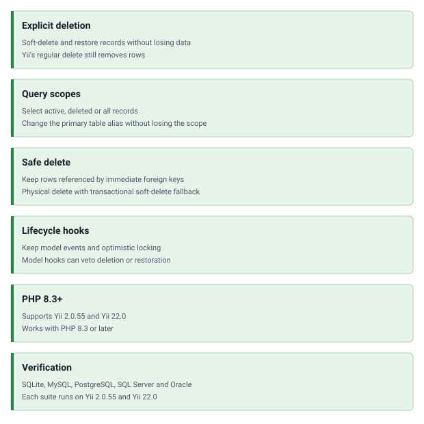

<!-- markdownlint-disable MD041 -->
<p align="center">
    <picture>
        <source media="(prefers-color-scheme: dark)" srcset="https://www.yiiframework.com/image/design/logo/yii3_full_for_dark.svg">
        <source media="(prefers-color-scheme: light)" srcset="https://www.yiiframework.com/image/design/logo/yii3_full_for_light.svg">
        
    </picture>
    <h1 align="center">Soft Delete</h1>
    <br>
</p>
<!-- markdownlint-enable MD041 -->

<p align="center">
    <a href="https://github.com/yii2-extensions/soft-delete/actions/workflows/build.yml" target="_blank">
        
    </a>
    <a href="https://codecov.io/github/yii2-extensions/soft-delete" target="_blank">
        
    </a>
    <a href="https://dashboard.stryker-mutator.io/reports/github.com/yii2-extensions/soft-delete/main" target="_blank">
        
    </a>
    <a href="https://github.com/yii2-extensions/soft-delete/actions/workflows/static.yml" target="_blank">
        
    </a>
</p>

<p align="center">
    <strong>Soft deletion and restoration for Yii2 ActiveRecord</strong><br>
    <em>Mark records as deleted without losing them, and restore them when needed</em>
</p>

## Features

<picture>
    <source media="(min-width: 768px)" srcset="https://raw.githubusercontent.com/yii2-extensions/soft-delete/main/docs/svgs/features.svg">
    
</picture>

## Quick start

### Installation

Install the package with Composer:

```bash
composer require yii2-extensions/soft-delete:^0.1
```

Applications on Yii 2.0 need a Bower asset source such as Asset Packagist. The
[Installation Guide](https://github.com/yii2-extensions/soft-delete/blob/main/docs/installation.md) covers it, together
with Yii 22 and local checkouts.

### Usage

A billing schema: `customer` has a `country` and a nullable `deleted_at` timestamp. `invoice` references it through a
`customer_id` foreign key and has a `status` and an `is_void` boolean that defaults to `false`.

```php
use yii\db\ActiveQuery;
use yii\db\ActiveRecord;
use yii2\extensions\softdelete\DeleteBehavior;
use yii2\extensions\softdelete\ScopedQuery;

final class Customer extends ActiveRecord
{
    public function behaviors(): array
    {
        return [
            'softDelete' => [
                'class' => DeleteBehavior::class,
                // Stamp the deletion time. restore() writes null back, and the scopes test IS [NOT] NULL.
                'softDeleteAttributeValues' => ['deleted_at' => static fn(): int => time()],
            ],
        ];
    }

    // Hide deleted customers by default: findOne(), relations, joins and eager loading all start here.
    public static function find(): ScopedQuery
    {
        return (new ScopedQuery(self::class))->notDeleted();
    }

    public function getInvoices(): ActiveQuery
    {
        return $this->hasMany(Invoice::class, ['customer_id' => 'id']);
    }
}

final class Invoice extends ActiveRecord
{
    public function behaviors(): array
    {
        return [
            'softDelete' => [
                'class' => DeleteBehavior::class,
                'softDeleteAttributeValues' => ['is_void' => true],
                // A draft never reached the ledger, so softDelete() removes its row instead of marking it.
                'allowDeleteCallback' => static fn(Invoice $invoice): bool => $invoice->status === 'draft',
            ],
        ];
    }

    public static function find(): ScopedQuery
    {
        return (new ScopedQuery(self::class))->notDeleted();
    }

    // A paid invoice cannot be voided: softDelete() returns false and writes nothing.
    public function beforeSoftDelete(): bool
    {
        return $this->status !== 'paid';
    }
}
```

The scopes follow each query through aliases, joins and filters:

```php
// Active customers with an overdue invoice. Each table keeps its scope under its own alias,
// and voided invoices are excluded inside the JOIN, not after it.
$debtors = Customer::find()
    ->alias('c')
    ->innerJoinWith('invoices i')
    ->andWhere(['i.status' => 'overdue'])
    ->all();

// Removes the row when nothing references it. While an invoice still does, the foreign key
// rejects the delete and the customer is marked as deleted instead.
$customer->safeDelete();

// One call per invoice, three outcomes: a draft is removed, a paid one is refused, any other is voided.
$invoice->softDelete();

// Switch scope without losing the other filters.
$deleted = Customer::find()
    ->deleted()
    ->andWhere(['country' => 'CL'])
    ->all();
$total = Customer::find()
    ->withDeleted()
    ->count();

// Bring a customer back.
Customer::find()
    ->deleted()
    ->andWhere(['id' => $id])
    ->one()
    ?->restore();
```

`filterDeleted()` maps a request value to a scope, and writes honor optimistic locking; the
[Usage Examples](https://github.com/yii2-extensions/soft-delete/blob/main/docs/examples.md) show both. The
[Configuration Guide](https://github.com/yii2-extensions/soft-delete/blob/main/docs/configuration.md) details
transactions and the foreign-key fallback.

## Documentation

Practical guides for configuring soft deletion, querying records, and running the test suite.

- 📚 [Installation Guide](https://github.com/yii2-extensions/soft-delete/blob/main/docs/installation.md)
- ⚙️ [Configuration Guide](https://github.com/yii2-extensions/soft-delete/blob/main/docs/configuration.md)
- 💡 [Usage Examples](https://github.com/yii2-extensions/soft-delete/blob/main/docs/examples.md)
- 🧪 [Testing Guide](https://github.com/yii2-extensions/soft-delete/blob/main/docs/testing.md)

## AI assistance

AI agents: read the [documentation index](https://yii2-framework.github.io/docs/llms.txt) and fetch the Markdown version
of a page by appending `index.md` to its URL. The
[AI agents guide](https://yii2-framework.github.io/docs/project/ai-agents/) covers skill installation, client setup and
verification.

- 🧭 [`yii2-framework` skill](https://yii2-framework.github.io/docs/guide/skills/yii2-framework/): Yii 22.0 application
  conventions.

The hosted documentation covers Yii 22.0. If it does not match the installed revision or is unavailable, use the
[repository guides](#documentation), the source PHPDoc and the [changelog](CHANGELOG.md).

## Package information

[](https://www.php.net/releases/8.3/en.php)
[](https://github.com/yiisoft/yii2/releases/tag/2.0.55)
[](https://github.com/yiisoft/yii2/tree/22.0)

## Project status

[](https://github.com/yii2-extensions/soft-delete/actions/workflows/static.yml)
[](https://github.com/yii2-extensions/soft-delete/actions/workflows/quality.yml)
[](https://github.styleci.io/repos/1467889568?branch=main)

## Security

[](https://scorecard.dev/viewer/?uri=github.com/yii2-extensions/soft-delete)
[](https://github.com/yii2-extensions/soft-delete/actions/workflows/security.yml)

## Built with AI

[](https://claude.com/claude-code)
[](https://openai.com/codex)
[](https://www.coderabbit.ai)

## Our social networks

[](https://x.com/Terabytesoftw)
[](https://www.facebook.com/wilmer.arambula.9)
[](https://www.reddit.com/r/Yii2/)
[](https://t.me/yii_framework_in_english)

## License

Based on [Yii2tech AR Soft Delete](https://github.com/yii2tech/ar-softdelete), originally developed by Paul Klimov.

[](LICENSE)
